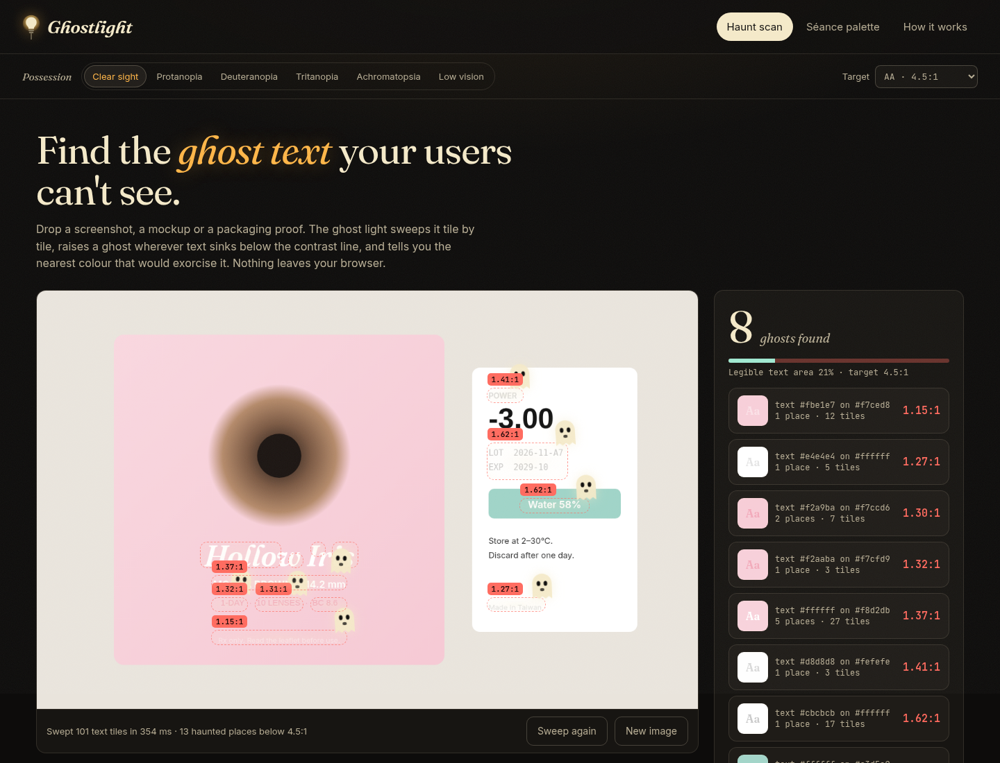

# 👻 Ghostlight

**Find the ghost text your users can't see — and exorcise it.**

Drop a screenshot, a mockup or a packaging proof. Ghostlight sweeps it with a "ghost light",
raises a ghost wherever text sinks below the WCAG contrast line, and repaints it with the
*nearest* colour that passes — moving only lightness, so your hue and your brand survive.

- **Live demo:** https://old.lat/ghostlight/ (no sign-in; try the two haunted samples)
- **Category:** Kiroween 2026 · Costume Contest
- **Built by:** Oldlee (Mingbin Li), designer & AI developer, Malaysia
- Runs 100% in the browser. No uploads, no accounts, no tracking.



## Why

Low-contrast text is one of the most common accessibility failures on the web, and it is
everywhere in print too: pastel packaging, light-grey placeholder copy, white labels on mint
buttons. Designers know the rule but rarely check every string — a contrast checker that needs
two hex codes at a time doesn't fit how we actually work (in screenshots and proofs).

"Ghost text" is already what designers call text you can barely see. Ghostlight takes the
metaphor literally, and every spooky element *does a job*:

| Spooky element | What it does |
|---|---|
| **Ghost light** (the lamp left burning on an empty stage) | The scanner sweep, and a cursor spotlight for inspecting the stage |
| **Ghosts & hauntings** | Places where text is below the target ratio, grouped by colour pair |
| **Exorcise** | Computes the nearest passing colour and repaints the pixels on the stage |
| **Possession** | Protanopia, deuteranopia, tritanopia, achromatopsia and low-vision blur |
| **Séance** | A palette matrix where every colour meets every other colour; failing pairs fade |

## Features

1. **Haunt scan** — drop/paste/upload any image (or use a sample). Tiles are filtered for
   text-like strokes, measured with WCAG 2.2 contrast, merged into hauntings, and grouped into one
   ledger entry per colour pair ("3 places · 32 tiles").
2. **Exorcise** — one ghost or all of them. The suggested colour keeps OKLCH hue and chroma and
   changes lightness by the smallest amount that passes. The stage repaints with anti-aliasing
   preserved, and the legibility meter fills up.
3. **Possession** — re-scan the image as people with colour-vision deficiencies or low vision see it.
4. **Séance palette** — up to 8 colours, full text/background matrix, "Exorcise all", export as
   CSS custom properties and a Markdown report.
5. **Targets** — AA (4.5:1), AA large (3:1), AAA (7:1). Ratios are floored, never rounded up:
   a 4.497 is a ghost.

## Run it

No build step.

```bash
npm install        # dev only: fast-check for property-based tests
npm test           # 38 tests: examples + fast-check properties
npm run serve      # http://localhost:5173
```

Any static host works (it is plain `index.html` + ES modules + self-hosted fonts).

## Project layout

```
.kiro/
  steering/      product.md (vocabulary), tech.md (conventions), design-system.md (fileMatch)
  specs/color-engine/  requirements.md · design.md · tasks.md (3 revisions)
  agents/        ghost-smith.json (builder, with hooks) · ghost-auditor.json (read-only reviewer)
  hooks/         test-on-save.json (PostFileSave hooks)
src/engine/      color.js · cvd.js · scan.js · repaint.js   (pure, no DOM, tested in Node)
src/ui/          app.js · samples.js                          (DOM + canvas)
test/            color · cvd · scan · repaint (.test.js)
docs/            self-audit.md, screenshots
```

## How Kiro was used

I used **Kiro CLI** (signed in with AWS Builder ID) in a headless setup — `kiro-cli chat
--no-interactive` driven from scripts — because my build machine was a remote Linux box with no
desktop. Everything below is in `.kiro/` and in the git history.

**Steering first.** Before any code I wrote three steering docs: `product.md` fixes the
vocabulary (ghost, possession, exorcise, séance) and the rule *"the metaphor must explain the
function"*; `tech.md` fixes the architecture (pure engine, no build step, every engine function
gets a property test, ratios floored); `design-system.md` is `fileMatch`-scoped to CSS/HTML/UI
files so palette rules only load when Kiro touches the interface. The biggest win was the
"floor, never round up" line: Kiro carried it into requirements, design, implementation and a
property test without me repeating it.

**Spec-driven engine.** Kiro generated `.kiro/specs/color-engine/` from a one-paragraph brief:
46 numbered EARS-style requirements, a design with data types, algorithms and 33 correctness
properties, and a 24-task plan with requirement traceability. I then had it implement the plan
phase by phase. Compared with vibe coding, the spec meant each run had a small, checkable scope
— important on a free tier where long generations got throttled.

**The spec evolved with real screenshots.** Revision 1 treated any non-flat tile as text.
Scanning a real landing page showed noise and gradients flagged as ghosts → *Revision 2*
(REQ-47..50: flat threshold, text-likeness, anti-aliasing core, 8-connected merge). The next scan
flagged rounded box corners → *Revision 3* (REQ-51: glyphs cross both rows and columns; corners
don't) plus REQ-52, a performance requirement that made Kiro rewrite the scanner with typed
arrays (375 → ~240 ms on the landing sample). The landing sample went from 24 haunted places,
many of them box edges, to 16 places in 6 colour groups — all real text.

**Custom agents.**
- `ghost-smith` — the builder. Its prompt says: work only from `tasks.md`, keep `src/engine`
  pure, test-first, tick boxes only when tests pass. Resources load steering + specs.
- `ghost-auditor` — read-only (`fs_read` + shell). It runs Ghostlight's own engine against our
  UI palette. Result: every UI pair passes, see `docs/self-audit.md`. An accessibility tool
  that fails its own audit would be a bad joke.

**Hooks.** `ghost-smith` has a `SessionStart`/agentSpawn hook (git status + recent log, so each
headless run knows where the last one stopped) and a `PostToolUse` hook on writes that runs the
test suite and feeds the last lines back to the agent. Honest note: in headless mode I could not
confirm from the logs that the hook output reached the model, so the agent prompt also tells it to
run `npm test` after every phase — that explicit loop is what I can vouch for. `.kiro/hooks/test-on-save.json` holds the IDE-style `PostFileSave` hooks
(engine tests on save; agent self-audit when `styles.css` changes).

**Property-based testing.** Every engine module has fast-check properties: contrast is in
[1, 21] and symmetric; the displayed ratio never exceeds the real one; `exorcise` always reaches
the target, is idempotent, and never touches a colour that already passes; CVD output stays in
gamut and achromatopsia preserves luminance; the scanner is deterministic and its verdicts match
its ratios; repainting never touches pure background and never smears flat areas. The
repaint property *"a large flat area that shares the text colour is left alone"* was written
after a bug where exorcising white text on a mint button painted a black bar on the white label
next to it.

**What I did by hand.** The visual design, the UI layer (`src/ui/`), the haunted samples, the
repaint step and its tests, and the final integration. Kiro wrote the spec and the engine
(`color.js`, `cvd.js`, `scan.js`) and their tests.

**Not used:** MCP servers and Kiro powers (no external services needed — everything is local),
and Kiro Crew.

## Limits

Ghostlight is a design aid, not a certification. It measures WCAG 2.x contrast of the dominant
two colours in each tile; it doesn't read text, check font size/weight, or replace testing with
real people. Photographic backgrounds behind text can confuse the two-cluster model.

## Credits & licence

MIT © 2026 Oldlee (Mingbin Li). Fonts: Fraunces, Inter, JetBrains Mono (SIL Open Font
License), self-hosted. Colour-vision matrices: Machado, Oliveira & Fernandes (2009). OKLab:
Björn Ottosson (2020). The brands in the samples ("nimbus", "Hollow Iris") are fictional.
Built for Kiroween 2026.
